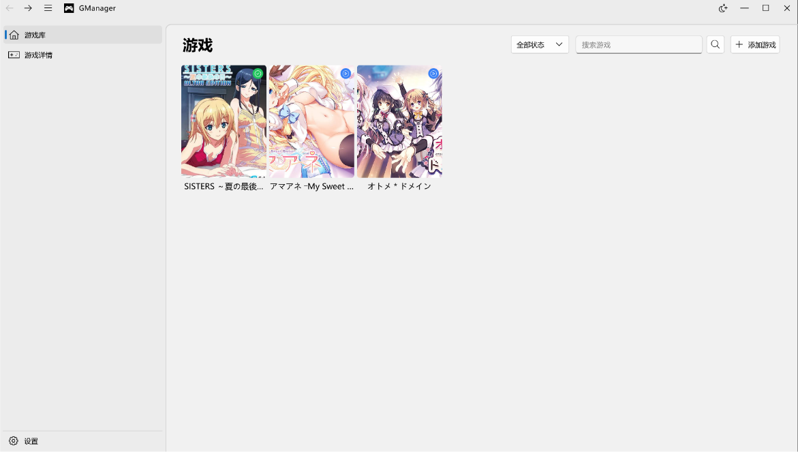
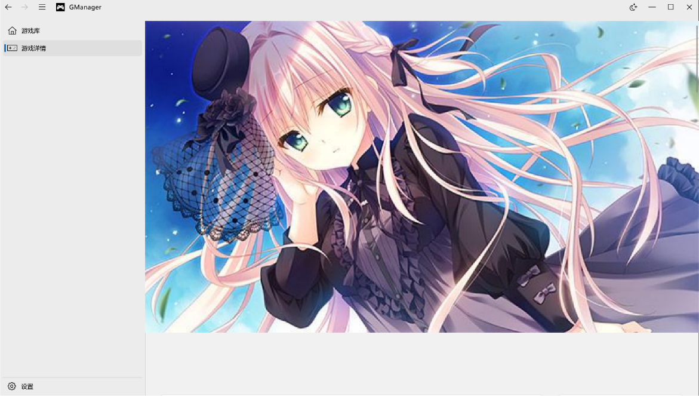
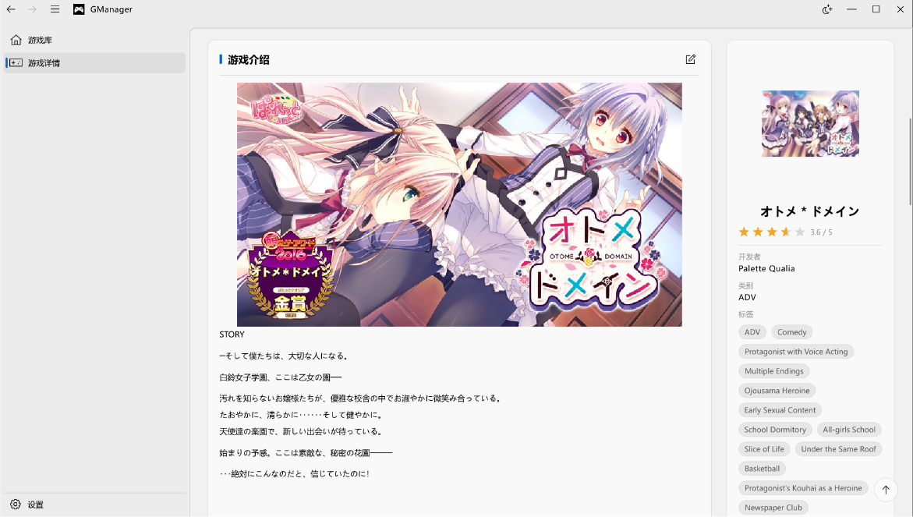

# GManager

基于 Qt Widgets 的本地游戏库管理器：把游戏收进自己的库，采用卡片流浏览，支持从公开刮削源补全信息与封面/横幅，界面使用 ElaWidgetTools 的 FluentUI 风格组件。

## 截图

| 游戏库 | 游戏详情 |
| --- | --- |
|  |  |
| 卡片流、状态筛选与关键词搜索 | 横幅背景、封面与信息列 |



详情页左列是富文本介绍（支持从刮削源带回来的 HTML、图片自动加载并自适应宽度），右列是评分、开发者、类别、标签与相关链接。

## 功能

- **游戏库**：卡片流展示本地库，支持按游玩状态筛选、按标题搜索；点击卡片进入详情页，卡片右键可跳转修改、设置游玩状态或从库中删除。
- **添加游戏**：从刮削源搜索条目，选定后挑选背景图，封面与横幅自动下载入库；也可以选“自定义”只填标题。
- **修改游戏信息**：手动编辑名称、评分、开发者、标签、类别、相关链接与详细介绍；也可“刮削”一次，把刮削结果显示成逐字段对比，每个字段都能选择沿用原始值、采用刮削值，标签与相关链接还能取两者并集。
- **修改图片**：封面与横幅可从链接、本地文件，或刮削源的候选图片里挑，预览确认后才写回库。
- **设置**：保存刮削服务所需的访问令牌（部分源未配置时只能刮削全年龄条目）。
- **运行细节**：单实例运行、操作日志落盘、网络图片磁盘缓存与自动清理。

## 环境要求

| 项目 | 要求 |
| --- | --- |
| Qt | Qt 6.8.3 实测通过。低于 5.12 或高于 6.8.3 会被直接拒绝，6.5.3~6.6.1 属于不推荐版本 |
| Qt 模块 | Widgets、Sql（SQLite 驱动）、Network |
| 构建工具 | CMake ≥ 3.12，支持 C++17 的编译器 |

`CMakeLists.txt` 里的 `QT_SDK_DIR` 默认指向作者机器上的 Qt 路径，构建前改成自己的路径，或直接用 `-DQT_SDK_DIR=/path/to/qt` 覆盖。

## 构建与运行

```bash
# 配置（build/ 已存在可直接复用）
cmake -S . -B build -DCMAKE_EXPORT_COMPILE_COMMANDS=ON

# 增量构建
cmake --build build -j"$(nproc)"

# 运行（可执行文件是 build/GManager）
./build/GManager

# 安装
cmake --install build
```

第三方库 `third_party/ElaWidgetTools` 以源码形式随仓库一起构建，无需单独安装。格式化只作用于自研代码，不要格式化 `third_party/`：

```bash
clang-format -i main.cpp mainwindow.cpp pages/*.cpp pages/*.h \
  widgets/*.cpp widgets/*.h utils/*.cpp utils/*.h data/*.cpp data/*.h
```

## 数据与配置

数据根目录：Windows 为可执行文件所在目录，Linux 遵循 XDG 规范（`$XDG_DATA_HOME/GManager`，默认 `~/.local/share/GManager`）。

| 内容 | Linux | Windows |
| --- | --- | --- |
| 数据库 | `<数据根>/games.db` | `<exe 目录>/games.db` |
| 本机配置 | `<数据根>/config.ini` | `<exe 目录>/config.ini` |
| 封面 | `<数据根>/data/covers` | `<exe 目录>/res/covers` |
| 横幅 | `<数据根>/data/banners` | `<exe 目录>/res/banners` |
| 网络图片缓存 | `<数据根>/cache/images` | `<exe 目录>/cache/images` |
| 日志 | `<数据根>/logs` | `<exe 目录>/logs` |

数据库中只保存封面/横幅的文件名，迁移时连同目录一起复制即可。

## 目录结构

| 路径 | 说明 |
| --- | --- |
| `main.cpp`、`mainwindow.*` | 程序入口（单实例检查）与无边框主窗口 |
| `pages/` | 首页、游戏详情页、设置页 |
| `widgets/` | 卡片、添加/修改对话框、图片选择与查看、网络图片浏览器、刮削检索与预览等自绘控件 |
| `data/` | `database.*`：SQLite 单例与 `GameInfo` |
| `data/scrapers/` | 刮削器接口、管理器与各源实现 |
| `utils/` | 路径、日志、配置、单例宏、图片缓存、介绍 HTML 规整 |
| `assets/` | 应用图片资源；`assets/readme/` 为本文档截图，不打包进程序 |
| `third_party/ElaWidgetTools/` | vendored 的 UI 组件库 |

## 致谢

- [ElaWidgetTools](https://github.com/Liniyous/ElaWidgetTools)：面向 Qt5/Qt6 的 FluentUI 风格 Qt Widgets 组件库。本项目的无边框窗口、导航、对话框、列表与消息提示等界面基础都来自它，源码以 `third_party/ElaWidgetTools` 的形式随仓库一起构建。
- Qt：GUI 框架、SQLite 驱动与网络模块（本项目通过 Qt 官方安装器获取）。
- 程序图标 `assets/images/gamepad.png`：来自 [Game-icons.net 的 Gamepad 图标](https://game-icons.net/1x1/delapouite/gamepad.html#download)，作者 [Delapouite](https://delapouite.com)，按 [CC BY 3.0](http://creativecommons.org/licenses/by/3.0/) 使用，未作修改。
- [Bangumi](https://bgm.tv) 与 [VNDB](https://vndb.org)：感谢这两个社区站点提供公开的条目资料与查询接口，本程序的刮削功能得益于它们的数据；条目信息与封面版权归各站点及原作者所有。

## 许可证

本项目按 **GNU Lesser General Public License v3.0**（LGPL-3.0-only）发布，版权归 GManager 作者所有：

- 许可证全文：[`LICENSE`](LICENSE)；
- LGPLv3 引用的 GPLv3 全文：[`LICENSE.GPL-3`](LICENSE.GPL-3)。

在遵守 LGPLv3 的前提下，你可以把本程序用于任何用途（含商业用途）、修改它，或把它与其他程序一起分发；分发修改后的版本时，需要一并提供对应源码，并保留接收者替换 Qt 与本项目库文件的权利。

第三方组件遵循各自的许可证，不受上述许可影响：

| 组件 | 许可证 | 说明 |
| --- | --- | --- |
| `third_party/ElaWidgetTools` | MIT | 声明见该目录下的 `LICENSE` |
| Qt 6（Widgets / Sql / Network） | LGPLv3 | 动态链接，可用自编译的同版本库替换 |
| `assets/images/gamepad.png` | CC BY 3.0 | 署名见“致谢” |

## 说明

- 截图中的游戏封面、介绍与标签来自刮削结果，仅用于演示界面效果。
- 素材与代码的许可分别适用：程序图标按 CC BY 3.0 使用，重新分发时请保留上面的署名；程序代码按 LGPLv3 使用，见“许可证”。
- 若某份分发物不含本 README，请把图标署名一并写进安装包的说明或“关于”对话框中，以满足 CC BY 的署名要求。
